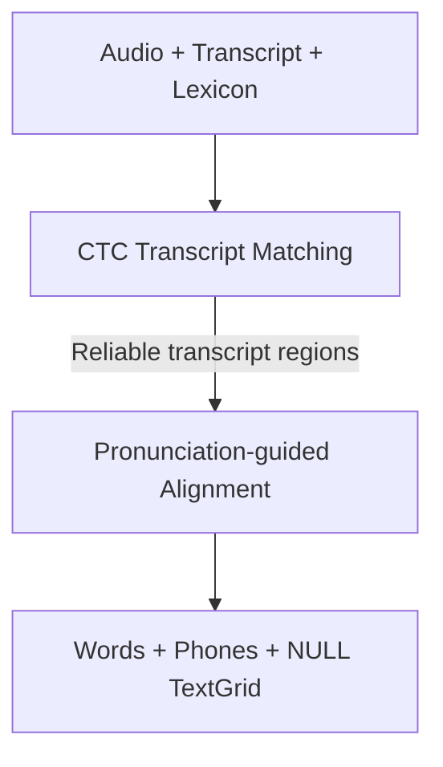

<div align="center">

# 🌊 FlexAligner

### Robust Speech-Text Alignment from Signal to Symbol

[](http://phonetics.ustc.edu.cn/)
[](https://pypi.org/project/flexaligner/)
[](https://www.python.org/)
[](https://github.com/USTCPhonetics/FlexAligner/actions/workflows/ci.yml)
[](LICENSE)
[](https://huggingface.co/USTCPhonetics/FlexAligner)

**A Neural-Based Forced Alignment Framework for "Wild" Real-World Data**<br>
**面向真实非受控数据的深度学习强鲁棒性对齐工具**

[**Introduction**](#-introduction) | [**项目简介**](#-简介) | [**Quick Start**](#-quick-start--快速开始) | [**Technical Details**](#-工作原理--technical-details) | [**Citation**](#-引用--citation)

</div>

---

## 📖 Introduction

**FlexAligner** is a wav2vec 2.0-based forced-alignment framework for speech and
transcripts that do not match perfectly. Real-world recordings often contain
background noise, laughter, hesitations, untranscribed events, or local
transcription omissions. Conventional aligners may force these regions into
nearby words and produce misleading boundaries.

FlexAligner first locates reliable transcript regions and then estimates word
and phone boundaries within them. The result is a Praat TextGrid; unmatched
time is represented explicitly as `NULL` rather than hidden inside neighboring
labels.

The `0.5.0a1` alpha aligns **English and Mandarin on CPU or NVIDIA CUDA**, for
single recordings or local corpora, and writes word- and phone-level Praat
TextGrids. Web services, automatic language detection, and calibrated confidence
scores are not part of the current alpha.

## 🌏 简介

**FlexAligner** 是一个基于 wav2vec 2.0 的语音—文本强制对齐框架，面向真实语料中
并不完美一致的音频与转写。背景噪音、笑声、停顿、未转写声音事件或局部漏记，
都可能使传统对齐器把不匹配时段强行挤入相邻词或音素。

FlexAligner 先定位可靠的文本对应区域，再在其中估计词和音素边界。
输出为 Praat TextGrid，未匹配时段使用明确的 `NULL` 区间表示，
而不是被隐藏在相邻标签中。

`0.5.0a1` alpha 支持在 **CPU 或 NVIDIA CUDA 上对齐英语和普通话单条录音或本地语料库**，
输出词级和音素级 Praat TextGrid。Web 服务、自动语言识别和经校准的置信度
不属于当前 alpha 范围。

### 🌟 Key Features / 核心优势

- **🛡️ Tolerance to Mismatch / 局部不一致容错：** CTC anchors isolate reliable
  regions without forcing every acoustic event into the transcript. CTC 锚点先隔离可靠
  区域，不强迫每个声学事件都匹配文本。
- **🎯 Word and Phone Boundaries / 词与音素边界：** Continuous `words` and
  `phones` tiers cover the complete timeline, including leading, internal, and
  trailing `NULL` intervals. 两个 tier 连续覆盖完整时间轴。
- **🌍 English and Mandarin / 英语与普通话：** Language-specific models,
  text processing, and local pronunciation support. 提供与语言匹配的模型、
  文本处理和本地发音支持。
- **🔒 Local and Reproducible / 本地与可复现：** Download models once and
  reuse them locally, including for offline alignment. 模型下载一次后可在本地
  重复使用，也可用于离线对齐。

---

## 🚀 Quick Start / 快速开始

### 1. Install / 安装

Use a Python 3.10–3.12 virtual environment. Install the appropriate PyTorch
2.3.1 build first, then FlexAligner with its language and audio extras.

请使用 Python 3.10–3.12 虚拟环境。先选择对应的 PyTorch 2.3.1，
再安装 FlexAligner 及语言、音频依赖。

```bash
python -m venv .venv
# Linux/macOS / Linux 或 macOS
source .venv/bin/activate
# Windows PowerShell: .venv\Scripts\Activate.ps1

# NVIDIA CUDA 12.1 wheels (Linux/Windows) / NVIDIA GPU 环境
python -m pip install torch==2.3.1 --index-url https://download.pytorch.org/whl/cu121

# OR CPU-only (Linux/Windows) / 或仅 CPU 环境，二选一
# python -m pip install torch==2.3.1 --index-url https://download.pytorch.org/whl/cpu
# macOS (CPU) / macOS 使用 CPU
# python -m pip install torch==2.3.1

python -m pip install "flexaligner[inference,en,zh,audio]==0.5.0a1"
```

The CUDA build requires a compatible NVIDIA driver; macOS uses CPU (not MPS).
These commands follow the [official PyTorch 2.3.1 installation options](https://pytorch.org/get-started/previous-versions/#v231).
CUDA 版本需要兼容的 NVIDIA 驱动；macOS 使用 CPU，不启用 MPS。
Torch 2.3.1 与 Transformers 4.41.2 保持固定版本。

### 2. Prepare the input / 准备输入

You need an audio file and a UTF-8 transcript. English also requires a UTF-8
pronunciation dictionary. The validated Mandarin model bundle includes a
reference dictionary; a custom dictionary is optional. Each dictionary line
has the form `WORD PHONE1 PHONE2 ...`; phones must match the selected alignment
model.

需要准备音频和 UTF-8 转写文本。英语还需要 UTF-8 发音词典；已验证的普通话
模型 bundle 已附带参考词典，自定义词典可选。词典每行格式为
`WORD PHONE1 PHONE2 ...`，音素必须与所选 Aligner 模型的词表一致。

By default, audio must be an uncompressed 16 kHz mono PCM16 WAV. The recommended
installation also provides explicit conversion for other audio formats.

默认音频必须是未压缩的 16 kHz 单声道 PCM16 WAV；推荐安装同时提供其他音频格式的
显式转换能力。

### 3. Get a model / 获取模型

When an alignment model is not yet available locally, the interactive CLI can
download it after asking for confirmation. You can also download a model in
advance:

本地尚无对齐模型时，交互式 CLI 会在取得确认后下载。也可事先主动下载：

```bash
# English / 英语
flexaligner models fetch --language en

# Mandarin / 普通话
flexaligner models fetch --language zh
```

The models are stored in the local Hugging Face cache. Both the official
Hugging Face service and `hf-mirror.com` are supported.

模型会保存在本地 Hugging Face 缓存中，支持 Hugging Face 官方服务和
`hf-mirror.com`。

### 4. Align / 执行对齐

```bash
# English / 英语
flexaligner align \
  --language en \
  --audio recording.wav \
  --text-file transcript.txt \
  --lexicon english.dict \
  --output recording.TextGrid
```

For Mandarin, use the same interface with `--language zh`. The cached model
bundle supplies the reference dictionary, so `--lexicon` is needed only for
custom pronunciations:

普通话使用相同接口，将语言切换为 `--language zh`。缓存的模型 bundle
会提供参考词典；只有需要自定义发音时才需要 `--lexicon`：

```bash
flexaligner align \
  --language zh \
  --audio mandarin.wav \
  --text-file mandarin.txt \
  --output mandarin.TextGrid
```

---

## 💻 Usage / 使用说明

### Pronunciation fallback / 发音兜底

Custom dictionary entries take priority over the bundled Mandarin reference
dictionary. Words found in neither dictionary can be handled by the local
English or tone-bearing Mandarin G2P frontend, with a warning in the CLI.
Important or ambiguous pronunciations should be specified explicitly.

自定义词典优先于普通话内置参考词典。两者都未收录的词可由本地英语或
带调普通话 G2P 前端处理，CLI 会同时给出警告。重要或存在歧义的发音应明确写入词典。

### Device and corpus alignment / 设备与语料库对齐

The default `--device auto` selects `cuda:0` when CUDA is available, otherwise
CPU. Use `--device cpu` for reproducible CPU runs, or select a GPU explicitly
with `--device cuda:1`; an unavailable explicit device is an error.

默认 `--device auto` 在 CUDA 可用时使用 `cuda:0`，否则使用 CPU。
需要固定 CPU 时使用 `--device cpu`；可用 `--device cuda:1` 明确指定 GPU，
指定设备不存在时会报错。

```bash
flexaligner align --language en --device cuda:0 \
  --audio recording.wav --text-file transcript.txt \
  --lexicon english.dict --output recording.TextGrid

flexaligner batch corpus/ aligned/ --language en --lexicon english.dict
flexaligner batch corpus/ aligned/ --language zh --device cpu --skip-existing
# Pair WAV with UTF-8 .lab instead of .txt / 使用同名 .lab 转写
flexaligner batch corpus/ aligned/ --language zh --text-extension lab
```

Batch alignment recursively pairs each WAV with its same-stem `.txt` (or `.lab`)
and mirrors relative paths into the output directory. Inputs and outputs must be
separate, non-nested directories; symlinks are not followed. Existing outputs are
conflicts unless `--skip-existing` is explicit; skipping does not validate old
outputs or resume interrupted work. Item reports and a summary are saved under
`aligned/_flexaligner_runs/<run-id>/`.

批处理递归配对 WAV 与同目录、同名的 `.txt`（或 `.lab`），按相对路径镜像输出。
输入输出目录必须分离且不能互相包含，不跟随符号链接。已有输出默认记为冲突；
只有显式 `--skip-existing` 才跳过，跳过不代表校验旧产物或恢复中断任务。
逐项报告和汇总保存在 `aligned/_flexaligner_runs/<run-id>/`。

Files are processed sequentially on one selected device. If a recording exceeds
available GPU memory, it is reported as failed without silently retrying on CPU.

文件在所选设备上逐项处理。若录音超出可用显存，会记录该项失败，不会静默转到 CPU 重试。

### Audio conversion / 音频转换

```bash
flexaligner audio convert input.flac canonical.wav
flexaligner align ... --audio-policy auto-resample   # WAV input only / 仅 WAV
flexaligner align ... --audio-policy multi-format    # PyAV decoding / PyAV 解码
```

Audio conversion is explicit; the default policy never converts silently.
音频转换必须显式启用，默认策略不会静默转码或重采样。

### Python API

The Python API accepts explicit local model directories and can be integrated
into reproducible research pipelines. Python API 接受明确的本地模型目录，可集成到可复现的
研究流程中。

```python
from pathlib import Path

from flexaligner import (
    AlignmentOptions,
    AlignmentRequest,
    Device,
    FlexAligner,
    LocalModelBundle,
    TextGridOutput,
)

models = LocalModelBundle(
    chunker_dir=Path("/local/models/en/chunker"),
    aligner_dir=Path("/local/models/en/aligner"),
)

with FlexAligner(
    models=models,
    lexicon_path=Path("english.dict"),
    options=AlignmentOptions(device=Device.AUTO),
) as aligner:
    result = aligner.align(
        AlignmentRequest(
            audio_path=Path("recording.wav"),
            transcript=Path("transcript.txt").read_text(encoding="utf-8"),
            output=TextGridOutput(path=Path("recording.TextGrid")),
            utterance_id="recording",
        )
    )

print(result.output_path)
```

For a batch, call `aligner.align_batch(requests)` with an iterable of
`AlignmentRequest` objects. It returns a `BatchReport`; each item has
`status`, `result`, and `error`. Pass `skip_existing=True` only when intentionally
retaining existing outputs. Explicit GPU selection in Python uses
`AlignmentOptions(device=Device.CUDA, device_index=1)`.

批量 API 为 `aligner.align_batch(requests)`，输入 `AlignmentRequest` 的可迭代对象，
返回 `BatchReport`；每项包含 `status`、`result` 和 `error`。
只有确定保留已有输出时才传入 `skip_existing=True`。
Python 指定 GPU 使用 `AlignmentOptions(device=Device.CUDA, device_index=1)`。

---

## 🏗️ 工作原理 / Technical Details



1. **Macro-Segmentation / 宏观切分：** CTC finds reliable transcript anchors while
   tolerating untranscribed acoustic events. CTC 在容忍未转写声学事件的同时寻找
   可靠文本锚点。
2. **Micro-Alignment / 微观对齐：** A constrained pronunciation graph and two-pass
   Viterbi decoder estimate word and phone boundaries inside each chunk. 受约束发音图和
   两遍 Viterbi 解码在每个片段内估计词与音素边界。

---

## 🗓️ Roadmap / 路线图

- [x] **Core Alignment Engine:** CTC chunking + local pronunciation-graph alignment
- [x] **English and Mandarin:** CPU/CUDA single-file CLI and Python API
- [x] **Continuous TextGrid:** complete `words`/`phones` timeline with `NULL`
- [x] **Model Retrieval:** local caching for English and Mandarin models
- [x] **Local OOV G2P:** lexicon-first English and Mandarin pronunciation fallback
- [x] **Audio Frontend:** explicit multi-format decoding, resampling, and conversion
- [x] **PyPI Public Alpha:** `flexaligner==0.4.0a1`
- [x] **GPU and Corpus/Batch Processing:** implemented in `0.5.0a1` (release pending)
- [ ] **Web Service and Confidence Calibration**

## 👨‍💻 Authors & Affiliation / 作者与机构

```text
Yiming Wang (王一鸣) - University of Science and Technology of China (USTC)
Jiahong Yuan (袁家宏) - University of Science and Technology of China (USTC)
```

## 📜 引用 / Citation

If you use FlexAligner in your research, please cite / 如果您在研究中使用 FlexAligner，请引用：

```bibtex
@misc{flexaligner2026,
  title        = {FlexAligner: Robust Speech--Text Alignment via CTC Chunking and Local Cross-Entropy Alignment},
  author       = {Wang, Yiming and Yuan, Jiahong},
  year         = {2026},
  publisher    = {GitHub},
  journal      = {GitHub repository},
  howpublished = {\url{https://github.com/USTCPhonetics/FlexAligner}},
  organization = {University of Science and Technology of China}
}
```

## ©️ Copyright & License / 版权与许可证

Copyright (c) 2026 USTCPhonetics

FlexAligner is released under the [MIT License](LICENSE). The optional
`flexaligner-g2p-en` distribution contains a checkpoint derived from
`g2p-en==2.1.0`, redistributed under Apache-2.0 with its license and attribution
notice.

FlexAligner 依 [MIT License](LICENSE) 发布。可选的 `flexaligner-g2p-en` 发行包包含源自
`g2p-en==2.1.0` 的 checkpoint，依 Apache-2.0 再分发，并随包提供许可证和归属声明。

<div align="center"><sub>Built by USTCPhonetics.</sub></div>
